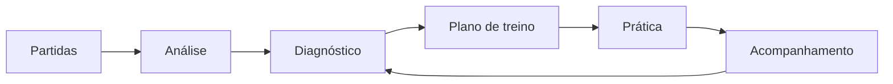
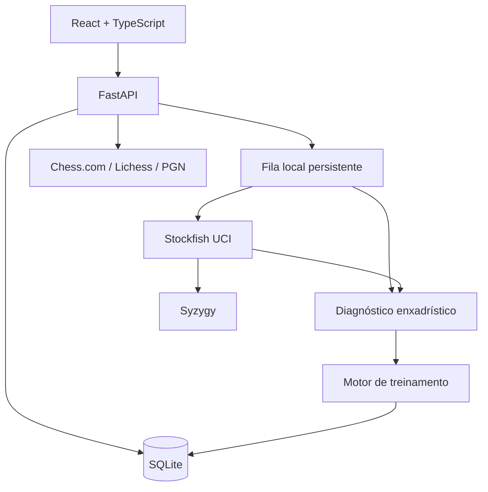

# Chess Builder

**Conheça seu jogo. Treine com propósito. Evolua.**

Plataforma local de análise e treinamento de xadrez baseada no histórico de partidas do jogador. O Chess Builder conecta análise computacional, diagnóstico de competências e prática personalizada em um ciclo contínuo de aprendizagem.

> Status: em desenvolvimento, com as fases F0–F16 integradas e validações adicionais em andamento. Acompanhe as [issues do projeto](https://github.com/carloshgalves/ChessBuilder/issues).

## Funcionalidades

| Módulo | Funcionalidades |
| --- | --- |
| Histórico | Sincronização Chess.com e Lichess, importação PGN, rating, evolução e retrospectiva |
| Análise | Stockfish, precisão, variantes, momentos críticos e revisão interativa |
| Diagnóstico | Temas táticos, erros estratégicos, competências por fase e prioridades de estudo |
| Treinamento | Exercícios pessoais, coleções temáticas, método Woodpecker e repetição espaçada |
| Aberturas | Repertórios, variantes, transposições, armadilhas e revisão |
| Finais | Posições teóricas, tablebases, defesa e conversão |
| Biblioteca | Partidas históricas, posições de estudo e importação de materiais particulares |
| Bots | Força calibrável, estilos de jogo e adversários personalizados |
| Torneios | Preparação, simulações e avaliação pós-competição |

## Ciclo de aprendizagem



O diagnóstico considera oportunidades, frequência, gravidade e recorrência dos erros. Os exercícios preservam a origem da posição e as variantes relevantes. O progresso é medido tanto nas sessões de estudo quanto nas partidas posteriores.

## Arquitetura



| Componente | Tecnologia |
| --- | --- |
| Interface | React, TypeScript e Vite |
| API local | Python e FastAPI |
| Regras e notação | python-chess |
| Análise | Stockfish / UCI |
| Persistência | SQLite, migrações e WAL |
| Finais | Syzygy |
| Testes | Pytest, Vitest e Playwright |

A aplicação é single-user, executada localmente, com análise progressiva, cache, retomada de jobs e limites configuráveis de recursos. O diagnóstico e o treinamento funcionam sem serviços generativos.

## Roadmap

| Fase | Entrega | Prioridade |
| --- | --- | --- |
| F0 | [Arquitetura e banco](../../issues/1) | P0 |
| F1 | [Importação de partidas](../../issues/2) | P0 |
| F2 | [Motor de análise e processamento](../../issues/3) | P0 |
| F3 | [Biblioteca e revisão de partidas](../../issues/4) | P0 |
| F4 | [Dashboard e retrospectiva](../../issues/5) | P0 |
| F5 | [Classificação tática](../../issues/6) | P0 |
| F6 | [Exercícios pessoais](../../issues/7) | P0 |
| F7 | [Competências e treinador diário](../../issues/8) | P0 |
| F8 | [Finais e tablebases](../../issues/9) | P1 |
| F9 | [Repertório de aberturas](../../issues/10) | P1 |
| F10 | [Woodpecker e repetição espaçada](../../issues/11) | P1 |
| F11 | [Biblioteca histórica e estratégia](../../issues/12) | P1 |
| F12 | [Importação de exercícios de livros](../../issues/13) | P1 |
| F13 | [Diagnóstico estratégico avançado](../../issues/14) | P1 |
| F14 | [Bots e calibração](../../issues/15) | P1 |
| F15 | [Preparação para torneios](../../issues/16) | P2 |
| F16 | [Extensão opcional de explicações](../../issues/17) | P2 |

## Fontes e ferramentas

- [Chess.com Published Data API](https://www.chess.com/news/view/published-data-api)
- [Lichess API](https://lichess.org/api) e [base aberta de exercícios](https://database.lichess.org/)
- [Stockfish](https://stockfishchess.org/)
- [python-chess](https://python-chess.readthedocs.io/)
- [PGN Mentor](https://www.pgnmentor.com/files.html)

## Dados e distribuição

Partidas importadas, históricos pessoais, PDFs, coleções particulares, avaliações e arquivos de tablebases permanecem no diretório local de dados. Materiais de terceiros mantêm sua proveniência e condições de uso.

O Chess Builder é destinado a estudo, análise pós-partida e preparação prévia para competições.

## Desenvolvimento local

Requisitos: Python 3.11+, Node.js 22+, npm. A partir da raiz:

```sh
python -m venv .venv
source .venv/bin/activate
pip install -e '.[test]'
uvicorn chessbuilder.main:app --host 127.0.0.1 --port 8000
```

Em outro terminal:

```sh
cd frontend
npm install
npm run dev
```

Abra http://127.0.0.1:5173. Os dados ficam em `~/.local/share/chessbuilder` (override: `CHESSBUILDER_DATA_DIR`). Execute `pytest` e, no frontend, `npm run build` e `npm test`.

### Stockfish

Instale o Stockfish pelo gerenciador de pacotes (Debian: `sudo apt install stockfish`) ou aponte `CHESSBUILDER_STOCKFISH` para o executável. Na aba Análise, configure nível, threads, hash e variantes; a fila processa uma partida por vez. Pausa e retomada ocorrem entre lances. Execute apenas uma instância do backend (um worker Uvicorn).

### Análise seletiva

Na aba Análise, selecione conta, origem, ritmo, período e tamanho do lote (padrão 100). A prévia não altera a fila. Partidas com análise concluída de profundidade e cobertura iguais ou superiores são ignoradas por padrão; uma análise rápida não bloqueia uma profunda; jobs interrompidos com as mesmas configurações podem ser retomados do checkpoint. Pausar todos interrompe a fila entre lances, preservando avaliações. Selecionar novo lote não pausa os jobs existentes automaticamente. O modo de aprofundamento automático fica desativado inicialmente para reduzir o custo da análise em lote.

### Integridade da análise

O progresso é medido por avaliações efetivamente gravadas em SQLite, associadas aos lances importados. Na inicialização, jobs marcados como concluídos sem cobertura integral voltam a pausado (ou falho se o PGN não tiver lances), sem iniciar automaticamente novas análises. Históricos vazios são reconstruídos a partir de PGNs locais compatíveis quando contêm lances. Registros genuinamente sem lances são preservados e identificados como não analisáveis. A retomada confere a identidade do motor; uma mudança de motor exige nova cobertura para evitar misturar avaliações incompatíveis.

### Replay e relógios

A revisão usa a disposição de jogadores, relógios e linhas pareadas adaptada do ChessCupMotorSimulation. Ratings são os registrados na partida. O tempo gasto usa `%emt` quando disponível; caso contrário, para controle simples de incremento Fischer, estima pela diferença entre dois relógios consecutivos do mesmo jogador mais incremento. O primeiro lance de cada lado, lacunas, controles por etapas e partidas por correspondência não recebem estimativa. Nenhum relógio ausente é substituído por zero. Os PGNs já importados são suficientes, sem migração ou nova análise.

### Gestão do tempo

O relatório, disponível na Visão geral, usa os filtros existentes e uma amostra explícita de até 200 partidas recentes. As taxas de erro usam somente lances avaliados com relógio anterior conhecido. Tempos ausentes permanecem ausentes, ritmos são separados e o relatório não afirma causalidade. O replay oferece reprodução automática em quatro velocidades e parada opcional em erros críticos. As avaliações já gravadas são reutilizadas.
